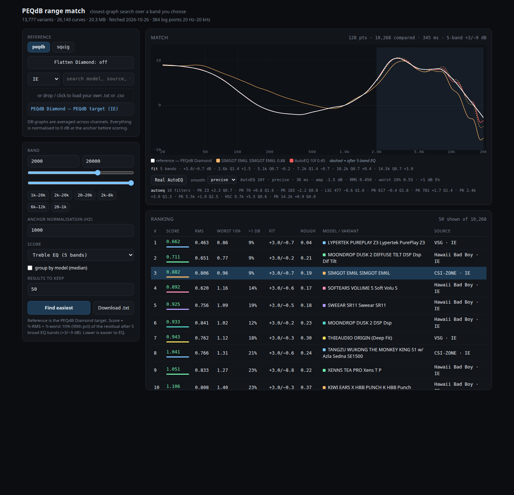

# PEQdB range match

Closest-graph search over a frequency band you choose, built on the same data
`peqdb.com/studio` uses for its **Find closest** button.

[](https://github.com/rodritimecoder/peqdb-range-match/actions/workflows/ci.yml)



Two modes:

- **peqdb** — score the 26,149-graph PEQdB catalogue against a reference you
  pick, or against the **PEQdB Diamond** target it opens with.
- **squig** — score community squig.link measurements against any of the 16
  PEQdB targets, including the Flat Line baseline.

Everything runs locally: no account, no API key, no telemetry.

## Quick start

Requires **Node 18 or newer**. No dependencies. The optional Real AutoEQ
overlay needs a C compiler; everything else runs as-is.

```sh
git clone https://github.com/rodritimecoder/peqdb-range-match.git
cd peqdb-range-match
node server.mjs
```

Open <http://127.0.0.1:7319>.

First start downloads `graph-data.bin` (20.3 MB, 26,149 graphs) from peqdb.com,
extracts the 16 target curves (15 preferences plus a Flat Line baseline) into
`data/targets.json`, and caches both. Later starts are offline. `data/` is gitignored; nothing is bundled.

## Platforms

Linux, macOS and Windows. The server is plain Node; the only native piece is
the optional `autoeq-c` binary, built locally. It binds loopback only. The
command is the same in a POSIX shell, PowerShell or Command Prompt:

```sh
node server.mjs
```

Use any current Chrome, Firefox, Edge or Safari. CI runs this suite on Linux,
macOS and Windows for Node 18 and 22. To pick another port, set `PORT`
(`PORT=7330 node server.mjs`; PowerShell: `$env:PORT=7330; node server.mjs`).

## Why it exists

PEQdB's own matcher (`function dt()` in `studio/assets/index-BWI7XDLZ.js`) cannot
answer "who has the closest treble", because it:

- throws away **7–9 kHz** entirely (coupler resonance), comparing only 20 Hz–7 kHz and 9–20 kHz
- weights the treble at **0.2 (IE) / 0.05 (OE)** while the bass counts at 1.0
- subtracts the mean deviation before scoring, so it judges shape and ignores level
- adds a treble-energy penalty rather than a per-point error

This tool scores only the band you ask for, at full weight, with no mean removal.

## Metric

Both curves are averaged across channels and normalised to 0 dB at the anchor
(1 kHz default). Then, over the grid points that fall inside `[lo, hi]`:

```
rmse = sqrt(mean((cand[i] - ref[i])^2))     dB, lower is better
```

`mean dB` and `max dB` are reported alongside. The grid is 384 log-spaced points
from 20 Hz to 20 kHz, so equal weight per point already means equal weight per
octave.

Raw RMSE answers "which graph is closest", not "which is easiest to EQ". The
**Score** selector switches to the 5-band EQ residual below.

## Treble EQ mode

A broad tilt costs one shelf; a narrow resonance may cost nothing you can
actually apply. **Treble EQ (5 bands)** ranks by what is left after a realistic
EQ fit:

- the deviation from the reference is fitted with 5 broad peaking bands
  (one per ½-octave centre, Q 0.7–1.4)
- gains are limited to **+3 / −9 dB** (cuts deeper than boosts)
- the score is **½ × RMS + ½ × worst 10%** of the residual, so a narrow spike
  or a broad bad region cannot hide in the average
- **>1 dB** shows how much of the band is still more than 1 dB off after the fit

The table shows **Score** (½ RMS + ½ worst 10%), **RMS**, **Worst 10%**
(90th-percentile residual), **>1 dB** (share of the band over 1 dB), **Fit**
(largest boost / cut) and **Rough** (RMS of the residual after 1/6-octave
smoothing). Selecting a row draws the fitted curve dashed over the raw one and
lists the chosen bands (centre, Q, gain) under the graph, so the score is
auditable. Selecting the mode narrows the band to 2k–20k when it was wider;
any band still works.

**Group by model (median)** collapses the per-measurement rows into one row per
model, using the median score and the median rig's curve; `min n` hides models
with fewer than that many measurements. Measurement spread is real: the Simgot
EM6L ranges from 0.88 to 3.82 over its 11 measurements, so one smooth rig is
not the model.

## Real AutoEQ (optional)

The **Real AutoEQ** button in the Match card runs the vendored
[`autoeq-c`](https://github.com/peqdb/autoeq-c) optimizer for the selected row:
10 filters, an overall gain offset, and the actual biquad response. It draws
the corrected curve in red and lists the preset under the graph.

Build the binary once:

```sh
npm run build:autoeq
```

This compiles `vendor/autoeq-c/src` with `cc`, `gcc` or `clang` into
`bin/autoeq` (gitignored). Without it the button is disabled; the rest of the
app is unchanged.

The **smooth** selector chooses autoeq-c's preprocessing:

- **precise** — no smoothing; the best raw 2k–20k fit.
- **IE / OE** — rig-aware adaptive smoothing and a treble roll-off. These are
  the modes AutoEQ uses for a subjectively better preset, but the raw 2k–20k
  residual can be higher above ~14 kHz because the optimizer deliberately stops
  chasing the treble.

The 5-band score remains the ranking metric; AutoEQ is a per-row detail view.
`autoeq-c` is LGPL-3.0-or-later; it is vendored under `vendor/autoeq-c` with its
own license and built as a separate executable, not linked into the MIT code.

## Default reference

The peqdb tab opens with the **PEQdB Diamond** target as its reference, so the
catalogue is scored against the house target before you pick anything. The same
target curves squig mode uses are searchable in the peqdb box: type `diamond`
and the target appears above the measured graphs, or pass `?ref=peqdb diamond`.
A catalogue hit still wins when `?ref=` matches a real measurement.

The **Flatten Diamond** button re-bases the view on the PEQdB Diamond target:
Diamond becomes 0 dB and every other target and candidate is shown as its
deviation from Diamond. The match scores are unchanged — subtracting the same
curve from both sides cancels — but the graph and the target comparison become
Diamond-relative. A highlighted row stays highlighted when you toggle, so the
curve you are looking at is re-based in place rather than the graph dropping
back to the top five. It works in both tabs and is deep-linkable as `?flat=1`.
The PEQdB `Baseline → Flat Line` target is still available in the target
dropdown for a plain 0 dB reference.

## Squig mode

The **squig** tab runs the same band-match against the community measurement
network ([squig.link](https://squig.link)). That cache is not shipped; build it
once (resumable through `data/squig/done.jsonl`):

```sh
node build-squig.mjs --sites achoreviews --concurrency 4     # a few sites
node build-squig.mjs --concurrency 24 --samples 3            # all 143 databases
```

- **Query curve** is a PEQdB target, extracted from the studio app bundle
  (`PEQdB Diamond`, `PEQdB Diamond β`, Harman IE 2019, the HiFiEndgame family
  and more — 16 targets in total, including the Flat Line baseline).
- **Candidates** are every community squig measurement: one index per
  reviewer site (`squigsites.json` → `<site>/<folder>/data/phone_book.json`
  → `<file> L.txt` / `R.txt`, plain TSV). Three schema quirks are handled:
  `file` arrays expand to one entry per variant (with `suffix` / `prefix`
  display names), rigs that store numbered repeats (`<file> L1.txt` …
  `L5.txt`) are averaged per channel before scoring, and the data directory
  is discovered per database (`data/`, `data/phones/`, `data/measurements/`)
  by probing a few real files. Probe results are cached in
  `data/squig/probes.json`.
- **Pool** defaults to every site in `squigsites.json`; `--sites acho,super.review`
  narrows it. Sites that block or no longer serve their `.txt` files are listed
  under `deadDbs` in `data/squig/meta.json` and left out of the index.
- IE / headphones are filtered with the `sCat` selector; totals and build
  freshness live in the sub line.

A full build is 143 databases, 42,219 measurement files, 74,363 curves and
57.7 MB, with 742 files missing network-wide at the time of writing. The builder
fetches the L and R channels and all samples in parallel; `--samples N` caps how
many numbered repeats are averaged (default 3). Known 404s are skipped on resume
unless `--retry-misses` is passed.

`node rank-squig.mjs` times four real `.txt` fetches per database and writes
`data/squig/speeds.json`; pass `--max-latency 750` to skip the slow tail. The
ranking is a snapshot, not a constant: two runs put between 36% and 74% of
databases under 400 ms and between 85% and 99.7% under 750 ms.

Artifacts land in `data/` (gitignored): `targets.json`, `squig-index.json`,
`squig/records.bin`, `squig/meta.json`, `squig/done.jsonl`, `squig/probes.json`,
`squig/speeds.json`. The server serves them at `/api/squig`, `/api/squig-data`,
`/api/squig-meta` and reports readiness at `/api/squig-status`; `/api/targets`
(alias `/api/squig-targets`) serves just the target curves, so peqdb mode gets
its default reference even when the squig record cache is absent. A 503 from any
`/api/squig*` route means "run the builder".

Squig records reuse the exact graph-data record schema (776 B, same scale/offset
int16 quantisation), so `decodeCurve`, `averageChannels` and `scoreBand` in
`public/core.mjs` service both datasets unmodified.

## Data format (reverse engineered)

`data/graph-data.bin` is a flat array of **776-byte records**:

| offset | type | meaning |
|---|---|---|
| 0 | f32 LE | scale |
| 4 | f32 LE | offset (stored negated) |
| 8 | 384 × i16 LE | quantised dB |

`dB[k] = scale * q[k] - offset`

`/studio/` also inlines `window.__INDEX__` — `{IE|OE: {source: {model: {variant: [startRecord, channelCount]}}}}`.
The two together are the whole catalogue; there is no API.

## Deep links

Every control is addressable, so a search can be shared or bookmarked:

```
http://127.0.0.1:7319/?ref=moondrop%20variations&lo=1000&hi=20000&cat=IE&top=50&anchor=1000
```

`ref` is matched by word against model and variant, then against the target
names; the first catalogue hit wins. Add `mode=eq` for the Treble EQ score,
`group=1` to collapse by model, `minn=2` for the minimum measurement count, and
`flat=1` to start in the Diamond-relative view.

## Test

```sh
node server.mjs     # once, so data/ exists
node test.mjs
```

The suite covers decode/normalise/band maths, raw RMSE, the 5-band EQ fit
(broad bump, comb, narrow spike), roughness, the AutoEQ biquad response, the
Diamond default and its relative view, and the squig record/phone-book
encoders.

## Data and attribution

- Catalogue graphs and target curves belong to [PEQdB](https://peqdb.com) and
  are fetched from its public studio bundle at runtime. This repository does not
  redistribute them.
- Community measurements belong to the individual reviewers and rigs indexed at
  [squig.link](https://squig.link); the builder fetches them from each site.
- The code is MIT (see [LICENSE](LICENSE)). The data is not covered by that
  license.
- The optional AutoEQ engine in `vendor/autoeq-c` is LGPL-3.0-or-later,
  copyright PEQdB Inc.; see `vendor/autoeq-c/LICENSE`. It is compiled into a
  separate executable and is not linked into the MIT code.
